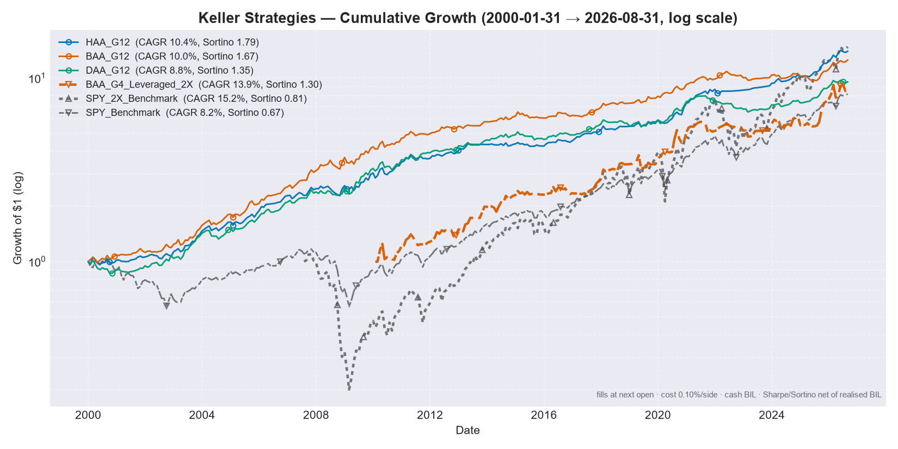
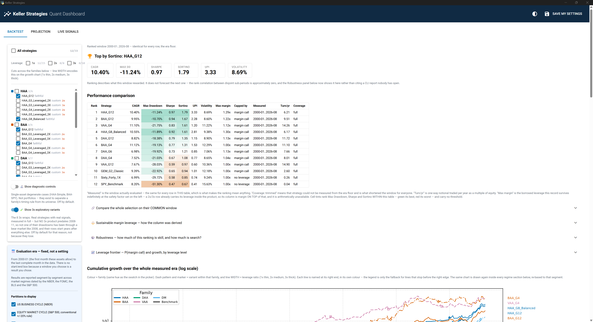

<!-- translation-of: README.md @ 5d00ce2f50eb4889f21c6155a5b22aea9e0283be -->

# Keller Strategies

[English](README.md) · **Français**


Un moteur Python à code source ouvert pour le backtest et l'exécution en direct de stratégies publiées
d'**allocation tactique d'actifs (TAA)**, fondé sur les recherches évaluées par les pairs du
Dr Wouter Keller, de Meb Faber, de Gary Antonacci et d'autres.

**Simon Kreis & Claude.** Réalisé avec l'IA, principalement Claude (Anthropic), qui a contribué en partie ou en totalité au travail. Simon Kreis en est responsable. Mise en œuvre de stratégies publiées par Wouter Keller et d'autres.

La suite met en œuvre le canon de Keller (HAA, DAA, VAA, BAA, PAA), vérifié ligne par ligne par rapport
aux articles sources, ainsi que le dual momentum d'Antonacci (GEM) et le GTAA de Faber, fondé sur le suivi de tendance. Elle
compare leurs performances de façon interactive et génère les signaux exacts de rééquilibrage mensuel,
y compris des variantes en ETF à effet de levier et une marge configurable.

**Ce moteur sert à la recherche et à la vérification ; il ne constitue pas un conseil en placement.** Rien n'y recommande une stratégie, un produit ou un niveau de levier ; voir l'[Avertissement](#disclaimer).

> **Reconstruit le 2026-07-28 après un audit adversarial**, qui a constaté que le prix d'exécution,
> la date de rééquilibrage, le coût de transaction, le sens d'un prix manquant et le sens des liquidités
> étaient tous *implicites* dans une seule expression vectorisée au lieu d'être modélisés. Il dispose désormais d'un
> registre d'exécution explicite, de garde-fous de couverture, d'indicateurs honnêtes et de manifestes de calcul.
>
> **Deux autres audits ont suivi le 2026-07-29** et ont trouvé ce que les vérifications du premier avaient contourné :
> DAA appliquait un filtre de momentum absolu que son article récuse à trois reprises, et `SMA12`
> faisait la moyenne de douze prix là où Keller en définit treize. L'un et l'autre ont modifié chaque chiffre publié de DAA, de BAA
> et de PAA.
>
> **Chaque chiffre de ce dépôt est plus bas qu'avant, et c'est bien le but.**
> [`KNOWN_GAPS.md`](KNOWN_GAPS.md) est la liste permanente de ce que ce moteur ne peut toujours pas
> établir. Lisez-la avant de citer le moindre chiffre.



> *Régénéré le 2026-09-23, sur l'ère qui commence en 2000-01 ; chaque courbe commence là où ses produits le permettent.* Exécution à l'ouverture de la séance suivante, coût de 0,10 %
> par sens sur chaque opération, poids non investi en BIL, Sharpe et Sortino nets du rendement réalisé
> de BIL, courbe de richesse partant de 1,0. Le titre indique la fenêtre **mesurée**, et non
> celle qui a été demandée.
>
> Lisez la courbe à effet de levier en gardant à l'esprit la réserve sur la couverture : ses produits n'ont aucun historique de marché baissier
> avant 2008, si bien que les deux courbes 2x commencent des années après les autres et manquent le marché baissier
> des dot-com. Voir [`KNOWN_GAPS.md`](KNOWN_GAPS.md).

## Points saillants

- **7 familles de stratégies, 35 variantes enregistrées.** Une entrée n'est admise que si elle est un univers publié par son auteur, le même univers sur des fonds de substitution, un univers que ce dépôt a été *contraint* d'inventer pour qu'une poche à effet de levier s'exécute à un multiple uniforme, un témoin à actif unique ou un portefeuille de référence passif. Seize entrées ont été retirées le 2026-07-28, cinq autres le 2026-07-29 et `DM_G8_Composite` le 2026-09-23 (sa composante de REIT hypothécaires est le seul produit ici sans donneur honnête antérieur à son lancement). L'une d'elles, `DAA_G3_Leveraged_2X`, a été rétablie le jour même, une fois la règle qui l'avait supprimée reformulée de façon à choisir un paramètre plutôt qu'à écarter une variante. Chaque ligne du rapport porte sa propre étiquette : `faithful` / `proxy` / `custom` / `control` / `benchmark`.
- **Les variantes à effet de levier ont leurs propres règles d'admission, écrites avant le backtest**, parce qu'elles sont la seule partie de ce dépôt qui n'a aucun auteur à qui s'en remettre. La règle décisive : *une enveloppe peut changer ce qui est DÉTENU, jamais ce qui décide de RÉDUIRE LE RISQUE.* VAA et PAA se protègent en comptant la largeur de leur propre univers offensif ; restreindre cet univers pour l'exécution en LETF réécrit donc la règle de protection au lieu de simplement resserrer le portefeuille ; **leurs variantes à effet de levier ont été supprimées, et pas parce qu'elles avaient de mauvais résultats.** HAA en a gagné une le jour même, selon la même règle. Voir [`LEVERAGE.md`](LEVERAGE.md) §8.
- **Tableau de bord de bureau (NiceGUI)** : des backtests *et* le calcul en direct d'ordres en parts entières sur plusieurs comptes de courtage, dans une fenêtre native. Double-cliquez sur `run_dashboard.bat` sous Windows, sans écrire de code.
- **Les réglages personnels restent privés** : les soldes des comptes, les choix de stratégies et tous les paramètres de l'utilisateur vivent dans un `user_config.json` ignoré par git, jamais dans le code.
- **Exécution en ETF à effet de levier** : un « schéma d'enveloppe » fidèle applique le signal canonique aux actifs 1x et associe la poche offensive à de vrais ETF à effet de levier (par exemple `SPY → UPRO`), en conservant la poche défensive à 1x. Seuls les univers qui s'exécutent à un multiple *uniforme* sont admissibles, et le module de correspondance l'impose dès sa construction.
- **Une seule source de données externe, et un deuxième avis sur elle.** Le moteur lit Yahoo Finance pour chaque prix négocié : pas de FRED, pas de série macroéconomique, pas de deuxième fournisseur dans le chemin du signal. La seule exception est un *donneur* d'historique : le fixing de l'or de la LBMA, récupéré une fois pour prolonger GLD avant son lancement en 2004, et qui ne fixe jamais le prix d'une barre négociée. Depuis le 2026-09-01, `tools/vendor_crosscheck.py` lit un fournisseur *différent*, à des fins de vérification seulement : aucun chemin du moteur ne l'importe, et il vit hors de `tests/` pour que la suite reste sans accès au réseau. Cet outil existe parce qu'on a trouvé dans le cache des prix deux millésimes d'ajustement des dividendes raccordés l'un à l'autre, invisibles pour chaque test de la suite : tous lisaient des données de test figées, si bien qu'une couche de données fausse de façon cohérente avec elle-même ne pouvait pas être vue. Voir [`KNOWN_GAPS.md`](KNOWN_GAPS.md) §2.
- **Un modèle d'exécution explicite** : exécution à la séance *suivant* le signal, coût par sens imputé à chaque opération sur le notionnel réellement négocié, positions qui dérivent entre les rééquilibrages, poids non investi dans un véritable actif de liquidités, et intérêts de marge calculés au jour le jour sur le solde réellement emprunté. Rien n'en est implicite ; tout est configurable.
- **Le moteur refuse plutôt que d'approximer** : un mois dont les poids ne totalisent pas 1, ou qui détient un ticker sans prix, lève une erreur au lieu d'être enregistré comme un rendement de 0 %. Une stratégie n'est jamais mesurée sur des années où ses propres produits n'existaient pas : la fenêtre est réduite et le ticker contraignant est nommé.
- **Des rapports qui argumentent contre eux-mêmes** : un panneau des régimes qui montre le comportement dans neuf replis nommés (`n/a` là où la couverture manque, jamais un chiffre), le meilleur des N attendu sous l'hypothèse nulle à côté du meilleur observé, et la corrélation des rangs du classement entre des sous-périodes disjointes. Elle ressort proche de zéro, et le rapport le dit.
- **Il n'y a pas de sélecteur de dates, et c'est voulu** : une fenêtre que vous choisissez est un résultat que vous choisissez. Le moteur calcule une ère fixe (2000-01 → le dernier mois *complet* : chaque stratégie publiée est mesurable depuis 2000-01, à travers le marché baissier des dot-com *et* la crise financière mondiale, parce que les années antérieures au lancement des ETF sont portées par des fonds communs indiciels plus anciens et par des indices publiés, chacun admis après mesure et signalé comme reconstruit ; voir [`KNOWN_GAPS.md`](KNOWN_GAPS.md) §2) et présente chaque stratégie selon quatre partitions préenregistrées de cette ère : le cycle économique du **NBER**, le cycle haussier/baissier du **S&P 500**, le cycle des taux du **FOMC** et les régimes d'inflation selon le **CPI du BLS**. Les segments couvrent l'ère sans trou ni chevauchement (un test les recompose pour retrouver le rendement de l'ère elle-même), et chaque panneau est mesuré sur l'historique *complet* de chaque stratégie, si bien qu'aucun calcul ne peut raccourcir un régime. Un `n/a` signifie que les actifs n'existaient pas, jamais « vous avez demandé une fenêtre plus courte ». Le tableau de classement utilise une seule fenêtre commune à toutes les lignes, déduite des données comme le lancement le plus tardif parmi les stratégies comparées, et **toutes** les stratégies contraignantes y sont nommées. Les égalités sont le cas normal, si bien qu'en nommer une seule rendait faux le conseil du rapport lui-même (« retirez-la pour allonger la fenêtre »). Depuis le 2026-07-29, les entrées que personne n'a publiées (`custom`) n'ont plus du tout le droit de fixer cette fenêtre : quatre enveloppes G4 à effet de levier coûtaient dix-neuf mois aux 25 lignes alors enregistrées et masquaient 2008 dans la colonne principale des replis. **Ce droit est aussi refusé à tout ce qui détient un produit à effet de levier, quelle que soit son étiquette de fidélité** : chaque LETF a été lancé en 2006 ou plus tard, si bien qu'un *portefeuille de référence* à effet de levier étiqueté `faithful` (100 % UPRO n'a aucune règle à laquelle être infidèle) aurait réintroduit le même défaut par l'étiquette plutôt que par le rôle. Les deux exclusions sont dans `main.may_set_ranked_window`. Les entrées exclues sont tout de même mesurées, dans un bloc séparé, sur leur propre fenêtre.
- **Trois réponses à « quelle fenêtre ? », parce qu'aucune n'est gratuite** : le tableau de classement donne UNE fenêtre aux entrées qui l'atteignent et mesure les arrivées tardives dans un bloc clairement séparé ; `RANKED_WINDOW_POLICY='all'` impose une seule fenêtre à tout, au prix du marché baissier de 2007-2009, la période la plus discriminante de l'historique ; et la **comparaison sur fenêtre commune** du tableau de bord croise les mois de tout ce que vous avez coché et remesure chaque entrée sur ces mois, en nommant l'entrée contraignante pour que vous puissiez la décocher. Idéale pour une question qui oppose deux ou trois entrées, la moins adaptée à une grande sélection.
- **Un classement par régime, pas seulement une matrice.** Sous les quatre tableaux de partition, chaque segment a son propre petit tableau de classement : qui a réellement mené pendant la crise financière mondiale, le krach de la COVID, le marché baissier de 2022. Il hérite de la règle unique du tableau de classement (chaque ligne couvre les mêmes mois), si bien qu'une stratégie entrée tard dans un segment est listée avec ce qu'elle a couvert et n'est **pas** classée. Arriver après le krach montre la reprise sans la chute, et classer cela reconstruirait le biais de sélection des dates dans le panneau même qui a été conçu pour l'éliminer. Le tableau de bord affiche la même chose sous forme de panneaux dépliables imbriqués.
- **UPI (Ulcer Performance Index)** : la principale mesure de classement de Keller lui-même, `(CAGR − rf) / Ulcer Index`, aux côtés de CAGR / MaxDD / Sharpe / Sortino / Volatilité.
- **La provenance sur chaque artefact** : chaque rapport enregistré s'accompagne d'un `*.manifest.json` qui contient le commit, l'empreinte des données, la configuration résolue et la fenêtre réellement mesurée.
- **Une suite de tests déterministe avec des points d'ancrage EXTERNES** : le momentum vérifié par rapport à une forme close dérivée dans le fichier de test, les paniers des stratégies par rapport à des calculs faits à la main, le coût par rapport au taux par sens indiqué dans l'article, et un golden master qui échoue volontairement chaque fois qu'une correction modifie un chiffre.
- **Chaque stratégie vérifiée par rapport à la règle de son propre article** : `tests/test_paper_rules.py` redérive la règle de sélection de chaque famille à partir de panneaux de données construits à la main, indépendamment du code. Il existe parce que deux défauts de conformité à Keller ont survécu à deux audits et à 131 tests d'auto-cohérence : DAA appliquait un filtre de momentum absolu que son article récuse à trois reprises, et `SMA12` faisait la moyenne de douze prix là où Keller en définit treize. L'un et l'autre ont modifié chaque chiffre publié de DAA, de BAA et de PAA. Voir [`KNOWN_GAPS.md`](KNOWN_GAPS.md) §7.
- **Chaque affirmation de fidélité porte une citation.** `faithful` / `proxy` / `custom` n'est plus une simple chaîne : chaque entrée nomme l'article, la section ou la figure qui la fonde, et un test vérifie que les 35 en ont une. Quatre étiquettes se sont révélées fausses jusqu'ici, toutes les quatre dans le sens d'une fidélité sous-estimée, si bien que depuis le 2026-07-30 le `(fidelity, paper, section)` de chaque clé est aussi épinglé dans `tests/test_paper_rules.py::TestFidelityAgainstSource`, où une étiquette fausse fait échouer l'intégration continue au lieu d'attendre que quelqu'un relise un PDF.

## Tableau de bord de bureau

```bash
python app.py        # native desktop window (or your browser as fallback)
```

Sous Windows, il suffit de **double-cliquer sur `run_dashboard.bat`** : le premier lancement installe
l'environnement automatiquement, les suivants démarrent instantanément.



- **Onglet Backtest** : réglez le levier de marge, le coût d'emprunt et le coût de transaction, et obtenez un
  tableau de classement des indicateurs (CAGR, repli maximal, Sharpe, Sortino, **UPI**, volatilité) qui montre
  aussi la fenêtre réellement **mesurée**, la rotation réalisée et toute réduction de fenêtre due à la couverture, plus un
  tableau dépliable par régime de marché (NBER / S&P 500 / FOMC / CPI), un graphique de croissance en échelle logarithmique
  et la dernière allocation cible de chaque stratégie. **Il n'y a pas de champs de date de début et de fin** :
  l'ère est fixe. Les nombres sont alignés à droite, et le repli maximal, le Sharpe et le Sortino sont
  teintés du vert au rouge *à l'intérieur* du tableau : une lecture relative, jamais un seuil.
- **Le sélecteur de stratégies est une liste à cocher, tout coché par défaut** : chaque stratégie est calculée sauf si vous
  la décochez, avec un interrupteur général et une case par famille. Il enregistre ce que vous avez *désactivé*
  (`EXCLUDED_STRATEGIES`), si bien qu'une variante ajoutée plus tard au registre apparaît d'elle-même
  au lieu d'être exclue par une liste écrite des mois plus tôt. Les deux **témoins** à actif unique
  sont cachés derrière un interrupteur : ce sont des diagnostics qui servent à séparer, dans l'historique d'une famille, sa
  règle de timing et son univers, pas des portefeuilles à détenir.
- **Le graphique de croissance encode de trois façons à la fois** : la couleur par famille, le motif de tirets et
  le marqueur par variante au sein de la famille, et chaque courbe nommée à sa propre extrémité droite, dans sa propre
  couleur. Une vingtaine de courbes tirées d'une seule palette continue n'étaient pas distinguables ; la
  légende se réduit maintenant à ce que les étiquettes ne peuvent pas dire, c'est-à-dire le sens des teintes.
- **Le graphique est tracé une fois par section de période, pas une fois par calcul** : l'ère entière en
  haut, puis de nouveau dans *chaque* segment de régime, ramené à 1,0 au début du segment et
  affiché la première fois que vous l'ouvrez. « Qu'est-ce que cela a rapporté pendant la crise financière mondiale ? » était déjà un
  nombre ; maintenant le trajet est là aussi, à une échelle où la crise ne fait pas quatre pouces de large. La
  catégorie ADVERSE en a un aussi, sur un axe ordinal, parce que ces mois ne sont pas
  contigus et qu'un axe des dates tracerait des lignes droites à travers les bonnes années qui les séparent.
- **Une colonne `Max margin`, et le plafond qui l'a produite** : combien de levier *emprunté*
  chaque historique supporte indéfiniment, d'après `common/margin_sizing.py`. Elle n'a besoin d'aucune donnée de
  votre courtier : le plafond de la ligne de crédit se déclare illimité plutôt que de deviner, le taux d'emprunt
  était déjà un paramètre, et l'exigence de marge de maintien provient d'une convention énoncée
  (30 % de base, multipliés par le multiple propre du fonds pour un produit à effet de levier). Deux colonnes plutôt
  qu'une, parce que `1.00x` issu du critère de Kelly (« l'argent emprunté aurait réduit la croissance ») et
  `1.00x` issu de la survie de la marge (« le courtier aurait liquidé vos positions ») sont des constats opposés
  qui affichent le même nombre.
- **Un panneau de robustesse qui argumente contre le tableau au-dessus de lui** : trois mesures, repliées
  et calculées seulement à l'ouverture. Les chiffres de **contexte de sélection** et de **stabilité des rangs**
  que la CLI affiche depuis des mois et que le tableau de bord se contentait de *citer* (« la corrélation des rangs
  entre des sous-périodes disjointes est approximativement nulle », en renvoyant à un rapport que personne n'avait ouvert).
  La **PBO**, la probabilité de surapprentissage du backtest, par validation croisée combinatoire
  symétrique sur les 12 870 découpages égaux de la fenêtre commune : **45,5 %<!-- facts:robustness.pbo_strategy:pct1 -->**, avec la
  première place dans l'échantillon d'apprentissage revenant à `HAA_G12` dans seulement 38,9 %<!-- facts:robustness.winner_share.0.1:pct1 --> d'entre eux. Et le classement **reconstruit sur
  2 000 historiques rééchantillonnés**, pour que « rang 1 » puisse se lire à côté de « parmi les trois premiers dans 76,0 %<!-- facts:robustness.top.0.p_top_k:pct1 --> des
  historiques alternatifs » : des affirmations différentes, désormais sur le même écran. Les deux mesures sont aussi
  calculées **par regroupement par famille et par mécanisme de réduction du risque**, parce qu'une famille dont chaque variante
  obtient un bon score s'explique plus difficilement par la chance qu'une seule variante chanceuse. Depuis que l'ère remonte
  à 2000, le regroupement par famille n'aide plus (45,5 % → 50,6 %<!-- facts:robustness.pbo_family:pct1 -->), et seul le regroupement par
  mécanisme aide (38,0 %<!-- facts:robustness.pbo_mechanism:pct1 -->) ; la famille HAA est parmi les trois premières dans 79,0 %<!-- facts:robustness.family_rank.HAA.p_top_k:pct1 --> des
  historiques alternatifs. Chaque chiffre est net du taux sans risque réalisé du calcul lui-même (le même taux que celui dont le
  classement est net), et la section affiche le taux utilisé. Rien de tout cela ne prédit : un bootstrap tire dans la distribution qu'on lui
  donne, et si ces vingt-six années ont été généreuses envers les actifs américains, alors chaque trajet rééchantillonné l'est aussi.
- **Une frontière de levier, qui recoupe le dimensionnement depuis une direction indépendante** : les mêmes
  historiques rééchantillonnés parcourus mois par mois à chaque niveau de levier constant de 1,0x à
  3,0x, selon la politique de réinitialisation mensuelle du registre lui-même et l'exigence de marge de maintien propre à chaque
  entrée. Trois courbes par stratégie (P(appel de marge), CAGR médian, CAGR au 5e centile),
  tracées en deux panneaux superposés (jamais un double axe), avec le conseil `Max margin` marqué
  dessus et sa P(appel) évaluée sur les trajets. Le plafond en forme close et le parcours des trajets partagent
  l'exigence de marge de maintien et le taux d'emprunt et *rien d'autre* ; mesurés, ils encadrent
  la même bande depuis des côtés opposés : un conseil de 1,0x à 1,3x, des appels de fin de mois significatifs seulement près de
  2,0x, l'écart étant exactement le facteur intrapériode que des trajets mensuels ne peuvent pas voir. La colonne de Kelly
  est le f qui maximise le CAGR médian sur l'ensemble des historiques rééchantillonnés, ruine comprise.
- **Onglet Projection** : donnez à chaque compte de courtage un type (enregistré ou non, au sens où `common/projection.py` les définit),
  un effort d'épargne mensuel et vos taux d'imposition, et obtenez la valeur après impôt P10 / médiane / P90 sur
  votre horizon, à côté d'un portefeuille de référence, d'un compte d'épargne et de l'argent que vous avez versé. Le rendement est
  le Sharpe décoté de la stratégie multiplié par sa volatilité, jamais son CAGR, et les hypothèses
  sont affichées au-dessus du graphique. C'est le même calcul que `python -m tools.projection`.
- **Onglet Live signals** : saisissez vos comptes de courtage (remplis par ordre de priorité) et les
  paramètres de dimensionnement des ordres, et obtenez des ordres exacts en parts entières par compte pour le signal
  mensuel en cours, avec l'état du canari et les liquidités restantes. Le signal est mensuel, mais les
  quantités sont calculées au **dernier cours du marché en direct** (avec repli automatique sur
  la clôture de fin de mois hors ligne), si bien que les ordres correspondent à ce que votre courtier facture réellement.
  Un **plafond de prix** facultatif (`PRICE_CAP_MARGIN_PCT`) dimensionne les parts à `quote × (1 + X%)`
  et indique le plafond pour chaque ordre. Saisissez-le comme prix limite maximal des ordres GTC hors séance
  (par exemple IBKR Midprice + plafond) : ils ne pourront jamais être rejetés pour fonds insuffisants.
- **Save my settings** enregistre tout dans `user_config.json` (ignoré par git), que
  la CLI lit aussi, si bien que l'interface graphique et `main.py` sont toujours d'accord. Le bouton clair/sombre à côté
  suit votre système jusqu'à ce que vous fassiez un choix, et ce choix est enregistré avec le reste.

Les téléchargements de données sont mis en cache, donc les calculs suivants sont rapides.

## Stratégies et recherche

La fidélité est revendiquée **stratégie par stratégie, jamais en bloc**. Voir
[`strategy_specs/`](strategy_specs), où chaque spécification cite l'article et la page et liste ses
écarts, et [`KNOWN_GAPS.md`](KNOWN_GAPS.md) §5 pour le résumé. Chaque article est lié sur
SSRN ci-dessous ; les PDF eux-mêmes ne sont pas redistribués ici (les conditions de SSRN permettent un téléchargement
personnel, pas une copie publique) ; téléchargez votre propre copie à partir du lien.

| Famille | Stratégie | Article source (SSRN) |
|--------|----------|---------------------|
| **HAA** | Hybrid Asset Allocation | [Keller, 2023](https://papers.ssrn.com/sol3/papers.cfm?abstract_id=4346906) |
| **BAA** | Bold Asset Allocation | [Keller, 2022](https://papers.ssrn.com/sol3/papers.cfm?abstract_id=4166845) |
| **DAA** | Defensive Asset Allocation | [Keller & Keuning, 2018](https://papers.ssrn.com/sol3/papers.cfm?abstract_id=3212862) |
| **VAA** | Vigilant Asset Allocation | [Keller & Keuning, 2017](https://papers.ssrn.com/sol3/papers.cfm?abstract_id=3002624) |
| **PAA** | Protective Asset Allocation | [Keller & Butler, 2016](https://papers.ssrn.com/sol3/papers.cfm?abstract_id=2759734) |
| **GTAA** | Global Tactical Asset Allocation | [Faber, 2006](https://papers.ssrn.com/sol3/papers.cfm?abstract_id=962461) |
| **DM** | Dual momentum : GEM, la stratégie phare à module unique | Antonacci, *Dual Momentum Investing* (2014) |

Les cinq stratégies de Keller ci-dessus ont été vérifiées ligne par ligne par rapport à leurs PDF sources par trois
audits (le troisième a trouvé et corrigé deux défauts que les deux premiers avaient manqués) et correspondent aux articles, y compris la formule exacte de la fraction de liquidités
`CF = (1/T)·rounddown(bT/B)` et le facteur de protection de PAA, `n1 = a·N/4`.

`DM_G8_Composite`, le composite équipondéré à quatre modules d'Antonacci tiré de
[SSRN 2042750](https://papers.ssrn.com/sol3/papers.cfm?abstract_id=2042750), a été **supprimé le
2026-09-23**. Non pour ses règles, qui étaient les siennes et vérifiées par rapport au tableau 10, mais pour son
historique : quand l'ère est passée à 2000-01, sa composante de REIT hypothécaires (REM, 2007-05) était le seul
produit du registre sans donneur admissible (les REIT hypothécaires encore cotés ont perdu 9 %
pendant la crise financière mondiale là où l'indice a perdu 52 %, parce que ceux qui ont fait faillite sont ceux qui
ont disparu), et, conservé, il aurait à lui seul maintenu la fenêtre de toutes les autres lignes à 2008-07.

**Retirées le 2026-07-28 :** FAA, MAA, EAA, LAA, RAA et CAA. Sur huit épisodes de repli nommés,
aucune d'elles n'a jamais surpassé l'ensemble des stratégies conservées, aucune ne mettait fidèlement en œuvre son article
source, et la corrélation mesurée de LAA avec le portefeuille de référence Golden Butterfly conservé était de ρ = 0,93. Justification
et preuves : [`KNOWN_GAPS.md`](KNOWN_GAPS.md) §6. Leurs articles restent sur SSRN, et leurs
spécifications tirées des articles restent dans [`strategy_specs/`](strategy_specs) (`faa.md`, `maa.md`, `eaa.md`,
`laa.md`, `raa.md`, `caa.md`), avec `mpt.md` pour l'article sur la MPT, qui n'a jamais été mis en œuvre.

Les spécifications détaillées des paramètres de chaque stratégie sont dans [`strategy_specs/`](strategy_specs) ; le
fichier [TIMELINE.md](TIMELINE.md) retrace l'évolution de la TAA, de Faber à Keller, et
[WHY_TAA.md](WHY_TAA.md) expose les raisons de l'allocation tactique.

> **Notre avis (une préférence, pas un classement impartial).** Nous penchons pour **HAA** pour des
> raisons *structurelles* : un seul canari externe (TIP) plutôt qu'un comptage de largeur, une poche défensive
> qui choisit entre BIL et IEF au lieu de se rabattre par défaut sur l'un des deux, et le plus récent des
> articles de Keller. Nous privilégions **G12** pour l'étendue des classes d'actifs (douze poches couvrant les actions américaines et hors États-Unis,
> les REIT, les matières premières, l'or et trois échéances obligataires), **non** parce qu'elle arrive première.
>
> Cette distinction est délibérée. Ce README affirmait autrefois que HAA_G12 avait « le meilleur
> Sharpe et le meilleur Sortino de la famille », ce qui était doublement faux : sur notre propre fenêtre, `HAA_G1_Simple` obtenait
> un meilleur score sur les deux, et dans les résultats **de Keller lui-même**, de décembre 1970 à décembre 2022, HAA-8 bat HAA-12 sur le
> repli maximal (−9,7 % contre −10,7 %) *et* sur le Sharpe (1,21 contre 1,19), pour un CAGR identique de 15,9 %.
>
> Plus généralement : **ne choisissez pas une variante à partir du tableau de classement.** Chaque rapport de backtest affiche
> la corrélation des rangs de ce tableau entre des sous-périodes disjointes, et elle ressort à
> approximativement zéro : l'ordre décrit ce que chaque régime a récompensé, il ne prédit pas
> le suivant. C'est à cela que sert le panneau des régimes situé en dessous. Il s'agit d'un parti pris personnel,
> non d'une recommandation scientifique ou impartiale, et **pas d'un conseil financier** (voir l'[Avertissement](#disclaimer)).

## Installation

Nécessite Python 3.11+.

```bash
git clone https://github.com/SimonKreis/keller-strategies.git
cd keller-strategies

python -m venv venv
source venv/bin/activate          # On Windows: venv\Scripts\activate
pip install -r requirements.txt
pip install pywebview             # optional: native desktop window for the GUI
```

Sous Windows, un double-clic sur `run_dashboard.bat` effectue toute cette installation au premier lancement.

## Utilisation

### Tableau de bord (recommandé)

```bash
python app.py            # or double-click run_dashboard.bat on Windows
```

### Réglages personnels : `user_config.json`

Toutes les valeurs propres à l'utilisateur (soldes des comptes de courtage, choix de stratégies, dates, levier,
paramètres de dimensionnement...) se trouvent dans **`user_config.json`**, à la racine du projet. Le fichier est
**ignoré par git**, si bien que vos données personnelles n'atteignent jamais le dépôt. Copiez
[`user_config.example.json`](user_config.example.json) pour commencer. Chaque clé est
facultative et se rabat sur les valeurs par défaut documentées dans la section USER DASHBOARD de `main.py`.
Le bouton *Save my settings* de l'interface graphique écrit le même fichier.

### Ligne de commande

```bash
python main.py                                           # run with your user_config.json (or the dashboard defaults)
python main.py --list                                    # list every available strategy key
python main.py --strategy HAA_G12 HAA_G4_Leveraged_2X    # run specific strategies
python main.py --live                                    # force live-signal mode
```

Paramètres clés (valeurs par défaut dans `main.py`, modifiables clé par clé dans `user_config.json`) :

```python
# No START_DATE / END_DATE: the era is frozen in common/eras.py and runs to the last
# COMPLETE month in the data. Putting those keys back in user_config.json prints a warning
# and changes nothing.
DATA_START_DATE    = '1998-11-01'   # Derived from the era: 13 months of momentum warm-up before 2000-01
LEVERAGE_FACTOR    = 1.0            # Global MARGIN leverage on active strategies (1.0 = none)
MARGIN_BORROW_RATE = 0.06           # Annual interest charged on the borrowed margin portion
EXECUTION_MODE     = False          # False = backtest, True = live target weights
```

- **Le mode backtest** calcule les allocations mensuelles historiques et produit un rapport de
  performance (CAGR, repli maximal, Sharpe, Sortino, volatilité) ainsi qu'un graphique de croissance en échelle logarithmique dans
  `backtest_results/`.
- **Le mode en direct** produit les poids cibles exacts du portefeuille pour la date configurée, et
  les traduit en ordres en parts entières sur plusieurs comptes de courtage, dans l'onglet *Live signals*
  de l'interface graphique ou dans la CLI. Les paramètres de dimensionnement des ordres (réserve de marge de sécurité, taille minimale
  d'opération, et `FLUSH_ROUND_UP_BAND_PCT` : arrondir le dernier lot à la hausse pour placer les liquidités inactives dans
  les comptes sans fractions de parts) sont documentés dans la section USER DASHBOARD de `main.py` et réglés
  pour chaque utilisateur dans `user_config.json`.
- **L'exécution en fonds cotés au Canada** de HAA_G12 (la même décision, achetée par l'intermédiaire de fonds canadiens
  en CAD ou en USD) est un pilote distinct, `python -m tools.ca_orders`. Ce n'est pas une
  stratégie et il ne figure pas dans le registre ; voir [`EXECUTION_CA.md`](EXECUTION_CA.md).
- **La projection de l'épargne** couvre ce que les comptes de `BROKER_ACCOUNTS` pourraient devenir avec des
  cotisations mensuelles, l'impôt selon le type de compte (les types que définit `common/projection.py`) et
  l'inflation : `python -m tools.projection` (`--demo` pour les comptes fictifs de l'exemple). Le
  rendement n'est pas le CAGR du backtest : c'est le Sharpe qui reste après les deux mêmes décotes que celles qu'applique
  le dimensionnement de la marge, multiplié par la volatilité de la stratégie, rééchantillonné à partir de son propre historique et
  affiché à côté d'un portefeuille de référence et d'un compte d'épargne, en CAD et en USD au taux du jour. Les
  hypothèses sont affichées avant tout chiffre,
  et chaque taux est à vous de saisir. C'est une hypothèse, pas une prévision. Voir
  [`KNOWN_GAPS.md`](KNOWN_GAPS.md) §4.

## Fonctionnement du levier

Le levier a deux sources indépendantes et combinables :

1. **ETF à effet de levier (2x/3x)** : le levier est obtenu à partir de l'historique *réel* des prix de produits comme
   UPRO/TQQQ/TMF, si bien que leur coût de financement interne et leur érosion due à la volatilité sont déjà
   pris en compte. Les poches défensives sont détenues sans levier, à 1x.
2. **Marge (`LEVERAGE_FACTOR`)** : levier par emprunt sur les stratégies actives, avec
   des intérêts sur la part empruntée imputés par `MARGIN_BORROW_RATE`.

Une stratégie en ETF 2x calculée avec `LEVERAGE_FACTOR = 1.3` atteint donc ≈ 2,6x
d'exposition effective. Voir [ARCHITECTURE.md](ARCHITECTURE.md) pour le détail des modules.

### La marge suit le signal

Les deux mécanismes ne sont pas symétriques, et la différence compte. **Un portefeuille d'ETF à effet de levier
réduit son levier de lui-même** : quand le canari bascule et que la stratégie passe d'UPRO
à IEF, l'exposition tombe automatiquement à 1x. **La marge fixe, non** : le prêt reste
tiré, si bien que la poche défensive est achetée avec de l'argent emprunté et que le portefeuille traverse le
repli avec effet de levier. Changer d'instruments en gardant le même facteur nominal modifie
discrètement le profil de risque.

`MARGIN_FOLLOWS_SIGNAL` (`true` par défaut) comble cet écart en n'empruntant que sur la
poche offensive :

```
effective_leverage = 1 + (LEVERAGE_FACTOR - 1) × offensive_weight
```

Le levier moyen réalisé et son étendue sont indiqués pour chaque stratégie, pour que l'exposition réellement
prise soit visible plutôt que supposée. Remesuré le 2026-09-23 sur
**2000-01 → 2026-08**, l'ère, que les trois atteignent grâce à des donneurs admis antérieurs à leur lancement
([`KNOWN_GAPS.md`](KNOWN_GAPS.md) §2), si bien que le tableau contient maintenant le marché baissier des dot-com et toute la
crise financière mondiale. Exécution à l'ouverture suivante, 0,10 % par sens, liquidités en BIL, Sharpe/Sortino nets de la série BIL,
emprunt à 6 % par an :

| Stratégie | Mode | CAGR | MaxDD | Sortino | UPI | Levier moy. | Rotation/an |
|---|---|---|---|---|---|---|---|
| HAA_G12 | sans levier 1,0x | 10,40 % | **−11,24 %** | **1,79** | **3,33** | 1,00x | 6,2 |
| HAA_G12 | fixe 1,3x | 11,54 % | −15,48 % | 1,55 | 2,46 | 1,30x | 8,1 |
| HAA_G12 | **suivant le signal 1,3x** | **11,66 %** | **−14,99 %** | 1,57 | 2,54 | 1,24x | 7,6 |
| DAA_G12 | sans levier 1,0x | 8,82 % | **−18,38 %** | **1,35** | **1,15** | 1,00x | 11,7 |
| DAA_G12 | fixe 1,3x | 9,46 % | −25,36 % | 1,14 | 0,83 | 1,30x | 15,2 |
| DAA_G12 | **suivant le signal 1,3x** | **9,70 %** | **−22,02 %** | 1,20 | 0,96 | 1,21x | 13,9 |
| BAA_G12 | sans levier 1,0x | 9,95 % | **−10,70 %** | **1,67** | **2,28** | 1,00x | 9,5 |
| BAA_G12 | fixe 1,3x | 10,95 % | −18,65 % | 1,44 | 1,58 | 1,30x | 12,4 |
| BAA_G12 | **suivant le signal 1,3x** | **11,00 %** | **−14,13 %** | 1,62 | 2,11 | 1,13x | 10,7 |

Deux conclusions distinctes, et seule la première porte sur l'option :

1. **Suivre le signal bat la marge fixe sur tous les indicateurs tout en empruntant moins.** Ce n'est
   pas de l'alpha : c'est la suppression d'un coût qui n'achetait aucune exposition, puisque la marge fixe
   paie des intérêts pour détenir des obligations du Trésor exactement pendant les mois où le signal appelait à la prudence.
2. **La marge à 1,3x achète du CAGR et vend tout le reste.** Par rapport à la base sans levier, elle
   augmente le rendement de +0,64 à +1,26 point de pourcentage, mais aggrave le repli maximal, le Sortino *et* l'UPI dans les six
   lignes avec levier, et augmente la rotation de 12 à 31 %. Les deux conclusions se lisent de la même façon sur la
   fenêtre antérieure, qui commençait en 2008-06 ; [`LEVERAGE.md`](LEVERAGE.md) §5 garde ce qui a changé. Savoir si cet échange vaut la peine relève de l'appétit pour le
   risque, pas d'une décision que le backtest prend pour vous ; notez aussi qu'un compte sur marge peut faire l'objet d'un appel
   en cours de mois, ce que ce modèle ne simule pas du tout
   ([`KNOWN_GAPS.md`](KNOWN_GAPS.md) §3).

Réglez l'option à `false` pour reproduire le comportement de la marge fixe. Les portefeuilles de référence passifs restent à 1x
dans les deux cas.

### Univers à effet de levier admissibles

Une stratégie à effet de levier n'est admissible que si **toute sa poche offensive s'exécute au
même multiple**. Mélanger les ratios (ou laisser un actif sans correspondance retomber à 1x) fait du
levier effectif une fonction du tirage mensuel du signal, et le backtest ne décrit alors
plus le portefeuille détenu. Deux règles encadrent chaque correspondance, documentées dans
[`common/letf_mapper.py`](common/letf_mapper.py) :

- **Homogénéité du levier** : un seul ratio sur toute la poche offensive. Les canaris et la
  poche défensive en sont exemptés : ils servent seulement au signal ou sont détenus à 1x par conception.
- **Plancher de liquidité de 100 M$** : pour un investisseur particulier, le risque déterminant est la fermeture du fonds par l'émetteur, pas
  l'écart de cours. Les produits sous ce plancher ont été retirés : `EURL`, `DRN` (3x) et `UBT`, `EET`,
  `EFO`, `URE` (2x). `UCO` a été retiré séparément parce qu'il suit le pétrole brut WTI plutôt qu'un
  indice large de matières premières.

| Univers | Actifs | 2x | 3x |
|---|---|---|---|
| G2 | SPY, QQQ | ✅ | ✅ |
| G3 | SPY, QQQ, IWM | ✅ | ✅ |
| G4 | SPY, QQQ, IWM, GLD | ✅ | ❌ aucun produit 3x sur l'or |
| G12 (univers complets de Keller) | + VGK, EWJ, VWO, VNQ, GSG, HYG, LQD | ❌ | ❌ |

**Les enveloppes 2x sont `role='strategy'` ; les enveloppes 3x sont `role='exploratory'`** : enregistrées, mesurées
et présentées en entier, mais exclues de toute statistique de sélection et interdites de fixer la
fenêtre de classement. Chaque version 3X présente, quant à la forme, une corrélation mesurée de ρ ≈ 0,996 à 0,999 avec sa version sœur 2X,
ce qui ne dit rien de la profondeur : sur 4 paires mesurées, les 4 montrent que le 3x augmente le CAGR de 2,5 à 5,1 points de pourcentage tout en
aggravant le Sortino *et* l'UPI et en creusant le repli de 13 à 22 points de pourcentage. Et aucun produit 3x n'est antérieur à
2008-11, si bien qu'aucun n'a d'historique de marché baissier. On obtient ainsi 15 variantes à effet de levier (sept 2x, huit
3x) dans DAA, BAA, HAA et DM, à côté de trois portefeuilles de référence à effet de levier. VAA et PAA n'admettent aucune enveloppe (leur protection est un comptage de largeur sur
l'univers même qu'une enveloppe doit restreindre ; voir `strategies/vaa.py` et `strategies/paa.py`).

## Tests

```bash
python -m unittest discover -s tests
```

Déterministes et sans accès au réseau. Quatre catégories, et ce sont les deux dernières qui comptent :

1. **Garde-fous.** Ce que le moteur doit REFUSER : un mois incomplet, une fenêtre antérieure aux propres produits d'une
   stratégie, des poids qui ne totalisent pas 1, un ticker détenu sans prix, un trou dans les données
   de plus de cinq jours de bourse, un canari qui se lit haussier sur des données manquantes, une segmentation des régimes
   qui laisse un trou ou un chevauchement dans l'ère, et un panneau de prix qui porte plus
   d'un millésime d'ajustement des dividendes.
2. **Golden master.** 8 stratégies × 6 indicateurs épinglés sur un jeu de données quotidiennes figé. Si un changement
   modifie un chiffre, ce test échoue *volontairement* ; régénérez-le dans le même commit, avec la raison.
3. **Points d'ancrage externes.** Des comparaisons avec des choses que le code n'a pas produites : 13612U vérifié
   par rapport à une forme close écrite dans le test, les règles de sélection et de substitution de HAA
   par rapport à des paniers calculés à la main, le coût de 0,1 % par sens indiqué par Keller, posé en arithmétique, et la
   forme des résultats publiés dans l'article sur HAA comme bande de vraisemblance.
4. **Règles des articles.** La règle de sélection de chaque famille, redérivée à partir de panneaux de données construits à la main et
   comparée à ce que son article énonce réellement. C'est la catégorie qu'un golden master
   ne peut pas remplacer : un golden master dit qu'un chiffre a bougé, jamais quelle règle est la bonne.

Les deux dernières existent à cause de ce que les audits ont trouvé. Avant le 2026-07-28, les 55 tests affirmaient tous
`f(x) == f(x)`, et chacun d'eux réussissait face à un moteur qui avait quatre défauts critiques ;
deux autres défauts de conformité à Keller ont ensuite survécu à deux audits et à 131 tests d'auto-cohérence.
**Un test qui ne compare le code qu'à lui-même ajoute de la couverture mais aucune assurance**, et, comme
l'a montré le 2026-09-01, une suite qui ne lit que des données de test figées ne peut pas remarquer que la couche de données
en direct est en désaccord avec son fournisseur. C'est à cela que sert `tools/vendor_crosscheck.py`.

## Outils

Des utilitaires autonomes, dans [`tools/`](tools). Aucun n'est importé par le moteur, et
aucun n'est nécessaire pour lancer un backtest : chacun s'exécute directement. Les commandes complètes et les mises en garde se trouvent
dans la docstring de module de chaque fichier.

| Outil | À quoi il sert |
|---|---|
| `backtest_driver.py` | Le point d'entrée sûr pour toute mesure. Il lit chaque paramètre dans `main`, puis force la désactivation d'`EXECUTION_MODE` et retire les comptes de courtage *après* avoir appliqué les surcharges de l'appelant, si bien qu'une mesure ne peut pas atteindre par accident le chemin des ordres en direct. Utilisez-le au lieu de `main.py` chaque fois que votre `user_config.json` règle `EXECUTION_MODE = True`. |
| `timing_luck.py` | Le rééquilibrage de fin de mois n'est qu'un tirage parmi vingt calendriers également défendables. Cet outil les fait tous passer par le même registre et présente la dispersion : ce qui transforme un repli affiché en une distribution. Les chiffres mesurés se trouvent dans [`KNOWN_GAPS.md`](KNOWN_GAPS.md), leur seul emplacement ; ce tableau dit ce que fait l'outil, pas ce qu'il a trouvé. |
| `proxy_fidelity.py` | Remesure chaque donneur d'historique (les fonds communs et les indices qui font remonter l'ère jusqu'en 2000) par rapport à l'ETF qu'il remplace, et affiche l'étalon à côté : l'écart entre deux VRAIS fonds de la même classe d'actifs. L'admission de chaque donneur est consignée dans `common/data_engine.HISTORY_BACKFILL` ; c'est ainsi que chacun peut la vérifier plutôt que de la croire sur parole. Il ouvre des connexions réseau, et vit donc ici et non dans `tests/`. |
| `emit_facts.py` | Régénère `tests/fixtures/run_facts.json`, l'artefact auquel les tests de documentation comparent la prose. Lancez-le quand un chiffre cité par la documentation a légitimement changé, et ajoutez le JSON au même commit que le changement qui l'a modifié. |
| `vendor_crosscheck.py` | Compare les clôtures brutes en cache à celles d'un deuxième fournisseur, rendements mensuels plus une sentinelle de fractionnement. La source est l'historique public des cours de Nasdaq (sans clé) ; Stooq, la première source, restreint l'accès automatisé depuis le 2026-09-01 et reste disponible avec `--provider stooq`. Premier passage complet, le 2026-10-04 : **35 tickers sur 35 comparés, 35 concordent.** `unavailable` n'est jamais compté comme une concordance. |
| `ca_orders.py` | La décision courante de HAA_G12 sous forme d'ordres en fonds cotés au Canada (`HAA_G12_CA`). Il lit le fichier `ca_execution.json`, ignoré par git, affiche le plan et le consigne dans `logs/`, également ignoré par git ; il ne passe jamais d'ordre. `--demo` s'exécute hors ligne sur un capital fictif. Voir [`EXECUTION_CA.md`](EXECUTION_CA.md). |
| `ca_execution_gap.py` | Mesure l'écart de chaque fonds canadien par rapport à l'ETF américain qu'il remplace, en USD, sur les douze lignes de la correspondance. Les six lignes équivalentes servent d'étalon : ce que coûte la seule structure canadienne. Les chiffres se trouvent dans [`EXECUTION_CA.md`](EXECUTION_CA.md). |
| `fx_rate.py` | Le taux USD/CAD qu'utilise le chemin canadien (saisi à la main, sinon le taux quotidien de la Banque du Canada, sinon Yahoo) ou une erreur : il n'y a pas de taux par défaut. |
| `projection.py` | Projette les comptes dans l'avenir sur l'historique décoté de la stratégie (`common/projection.py`) : P10 / médiane / P90 après impôt, en valeur nominale et en dollars d'aujourd'hui, face à son comparateur et à un compte d'épargne. Il lit le bloc `PROJECTION` de `user_config.json` ; `--demo` utilise les comptes fictifs de l'exemple. Il mesure par `backtest_driver`, avec un levier de 1,0. |

## Pourquoi le momentum ?

Le momentum est une observation de ce que les marchés font *réellement*, pas une thèse sur ce qu'ils
*devraient* faire. Le signal est le prix (la somme compressée de toute l'information et de tout le
positionnement), et une sortie fondée sur le suivi de tendance fournit une protection intégrée quand les actifs meneurs
changent. Appliqué au niveau des classes d'actifs au moyen d'ETF, il capte la prime de momentum
avec un risque idiosyncratique plus faible que les approches au niveau des titres, tandis que les signaux canaris (par exemple
VWO/BND) réduisent systématiquement le risque du portefeuille à mesure que les conditions se dégradent.

<a id="disclaimer"></a>
## Avertissement

**Ceci n'est pas un conseil financier.** Ce logiciel est destiné uniquement à des fins éducatives, de recherche et
d'information. Les performances passées ne garantissent pas les résultats futurs. Utilisation à vos propres risques.

## Contribuer

Les contributions sont les bienvenues. Voir [CONTRIBUTING.md](CONTRIBUTING.md) pour les consignes sur l'ajout de
stratégies ou l'amélioration du moteur.

## Licence

Publié sous la [licence MIT](LICENSE). Copyright 2026 Simon Kreis. Contact : Simon Kreis, M. Sc., [simon@kreisconsulting.ca](mailto:simon@kreisconsulting.ca).
